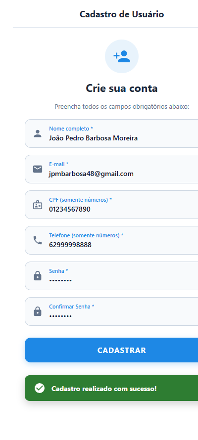
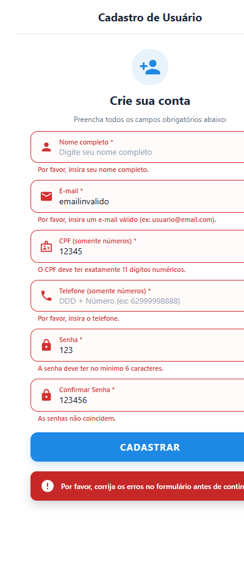

# Atividade Prática: Formulário de Cadastro de Usuário em Flutter

**Disciplina:** Desenvolvimento Mobile (Flutter e Dart)  
**Tema:** Formulários, Validações e Layout Responsivo no Flutter  
**Aluno:** João Pedro Barbosa Moreira  

---

## 📱 Visão Geral

Este projeto consiste na implementação de uma tela completa e moderna de **Cadastro de Usuário em Flutter**, focada em boas práticas de captura de dados, filtros de entrada (`inputFormatters`), validações granulares (`validator`), layout responsivo adaptável (`flutter-build-responsive-layout`) e feedback visual claro com `SnackBar`.

---

## 📸 Demonstração do Aplicativo

| 🟢 Cadastro com Sucesso | 🔴 Validação de Erros |
| :---: | :---: |
|  |  |
| *Validação aprovada com SnackBar flutuante de sucesso* | *Validação campo a campo e SnackBar de erro* |

---

## 🛠️ Requisitos e Implementações

### 1. Campos do Formulário e Regras de Validação

| Campo | Configuração e Filtros | Regra de Validação |
| :--- | :--- | :--- |
| **Nome Completo** | `TextInputType.name`, `TextCapitalization.words` | Obrigatório; mínimo de 3 caracteres. |
| **E-mail** | `TextInputType.emailAddress` | Obrigatório; deve conter `@` e seguir padrão RFC com `RegExp`. |
| **CPF** | `TextInputType.number`, `digitsOnly`, limite de 11 dígitos | Obrigatório; exatamente 11 dígitos numéricos. |
| **Telefone** | `TextInputType.phone`, `digitsOnly`, limite de 11 dígitos | Obrigatório; 10 ou 11 dígitos numéricos (DDD + número). |
| **Senha** | `TextInputType.visiblePassword`, `obscureText` alternável | Obrigatória; mínimo de 6 caracteres. |
| **Confirmar Senha** *(Desafio)* | `TextInputType.visiblePassword`, `obscureText` alternável | Obrigatória; deve ser idêntica à senha digitada. |

### 2. Desafios Implementados (Além dos requisitos básicos)

- ✅ **Confirmação de Senha:** Campo específico que valida em tempo real se ambas as senhas coincidem.
- ✅ **Mostrar / Ocultar Senha:** Botões de sufixo com ícones interativos (`Icons.visibility` / `Icons.visibility_off`) para ambos os campos de senha.
- ✅ **RegExp Avançado de E-mail:** Validação completa de formato de e-mail (`^[\w-\.]+@([\w-]+\.)+[\w-]{2,4}$`).
- ✅ **SnackBar de Erro (Vermelho):** Feedback imediato alertando para correção dos erros do formulário ao clicar em CADASTRAR.
- ✅ **SnackBar de Sucesso (Verde):** Confirmação positiva com ícone e cantos arredondados quando todos os campos são válidos.
- ✅ **Layout Responsivo (`flutter-build-responsive-layout`):** Centralizado com `ConstrainedBox(maxWidth: 550)` para evitar distorções em telas largas (tablets e desktop/web), além de `SingleChildScrollView` para prevenir estouro (*overflow*) com o teclado aberto.

---

## 🏗️ Estrutura da Árvore de Widgets

Seguindo rigorosamente a arquitetura solicitada:

```
Scaffold
└── SafeArea
    └── Center
        └── ConstrainedBox (maxWidth: 550 - Responsividade)
            └── Form (key: _formKey)
                └── SingleChildScrollView (prevenção de overflow)
                    └── Column
                        ├── Header visual (Ícone + Título + Subtítulo)
                        ├── TextFormField (Nome Completo)
                        ├── TextFormField (E-mail com RegExp)
                        ├── TextFormField (CPF numérico com formatter)
                        ├── TextFormField (Telefone numérico com formatter)
                        ├── TextFormField (Senha com toggle de visibilidade)
                        ├── TextFormField (Confirmação de Senha)
                        └── ElevatedButton (CADASTRAR com validação e SnackBar)
```

---

## 🚀 Como Executar

### Opção 1: No [DartPad](https://dartpad.dev)
1. Acesse [dartpad.dev](https://dartpad.dev).
2. Certifique-se de que o modo **Flutter** esteja selecionado.
3. Copie o conteúdo de [`main.dart`](main.dart) ou [`formulario_cadastro.dart`](formulario_cadastro.dart) e cole no editor.
4. Clique em **Run**.

### Opção 2: Localmente via Flutter CLI
```bash
# Clone o repositório
git clone https://github.com/barbooosa/Formul-rio-de-Cadastro-em-Flutter.git

# Acesse o diretório
cd Formul-rio-de-Cadastro-em-Flutter

# Execute o projeto
flutter run
```
